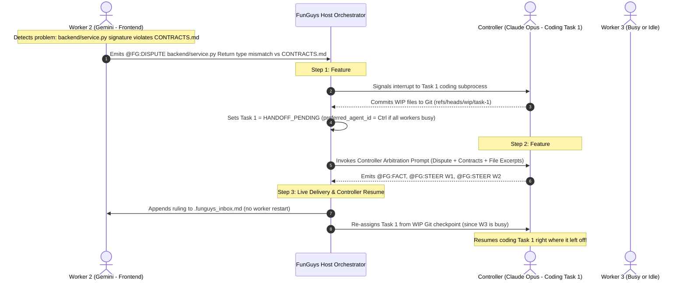

# Gaper Bingzoid (FunGuys) — Model A ("Player-Coach") Controller, Dispute Arbitration & Dynamic Handoff Plan (`PLAN_HUMAN.md`)

## 1. Executive Summary & Architecture Goal

This plan upgrades **FunGuys** to operate under **Model A (The "Player-Coach" 5-Agent Swarm Architecture)** while closing the remaining gaps identified in the 9-point capability audit:

1. **Model A ("Player-Coach" Swarm Utilization)**:
   - All **5 connected agents actively write code**—no agent is wasted sitting idle on the sidelines as a pure manager.
   - The **Main Controller Agent** (elected by planning headroom priority: **1st: Claude `opus:high` $\to$ 2nd: Google `argon:medium` $\to$ 3rd: ChatGPT `astra:low`**) plans the initial `CONTRACTS.md` and Task DAG, then rolls up its sleeves to execute critical Tier-1 `"important_coding"` tasks alongside the other 4 workers.
2. **Feature #9 — Mid-Work Task Drop & Baton Pass on Controller Promotion / Dispute Call**:
   - Whenever an active coding agent is promoted to **Main Controller**, or when the currently coding Controller is called upon mid-task to **arbitrate a worker dispute**, it immediately performs a **non-destructive task drop**:
     1. Cleanly interrupts its active coding subprocess.
     2. Checkpoints its uncommitted work-in-progress (WIP) files to a candidate Git branch (`refs/heads/wip/<task_id>`).
     3. Generates a structured Baton Pass handoff digest (`create_handoff_document`).
     4. Transitions the task to `HANDOFF_PENDING` so an idle worker can take over—**or, if all other workers are busy, sets `preferred_agent_id` back to the Controller so it automatically resumes its exact same task from its Git checkpoint as soon as arbitration finishes**.
3. **Feature #2 — Explicit Controller Arbitration Instructions & Worker Dispute Protocol (`@FG:DISPUTE`)**:
   - **Worker Problem Detection & Escalation**: Workers receive explicit instructions in `task_prompt()` on how to recognize blocking problems (terminal/import errors, `CONTRACTS.md` mismatches, Blackboard `[LOCK]`/`[TRIPWIRE]` collisions, or QA failures outside their assigned `target_files`) and escalate immediately via `@FG:DISPUTE <target> <reason>` instead of inventing hacks.
   - **Controller Arbitration Turn**: When a dispute is raised, the Host frees the Controller (via Feature #9) and invokes an authoritative arbitration turn (`run_text_agent` with `role="planning"`). The Controller receives full instructions on its duties: inspect the conflicting files and contracts, issue a binding decision, update `CONTRACTS.md` / Blackboard facts, and emit `@FG:STEER`, `@FG:HOLD`, `@FG:GO`, or `@FG:VETO` directives that stream directly into the affected workers' `.funguys_inbox.md` files without restarting them.
4. **Feature #4 — On-Demand Context Window Reset & Targeted Handoff (`@FG:HANDOFF` & `/api/agents/{id}/handoff`)**:
   - Any specific agent can have its context window reset on demand (by the Controller, the human admin, or the agent itself) without triggering a 60-minute quota cooldown.
   - Its WIP files are checkpointed to Git, a Baton Pass handoff digest is created, and the task is routed either to a **specifically selected target agent** (`target_agent_id`) or back to a fresh, clean CLI session of the same agent.

---

## 2. End-to-End Workflow: How Model A + Feature #9 + Dispute Resolution Works

### Key Questions Answered by This Design
1. **What if all other workers are busy when the Controller drops its task to solve a dispute?**
   - When the Controller drops its task for dispute arbitration, `preferred_agent_id` defaults to the Controller's own `agent_id` if no other qualified worker is idle.
   - Because `HANDOFF_PENDING` tasks sort to the very top of `schedule_ready_tasks()`, the moment the Controller finishes its 1-turn arbitration ruling, the scheduler immediately hands the task back to the Controller with its saved Git WIP branch (`task.candidate_revision`) intact.
2. **How does a worker know it has hit a problem?**
   - **Feedback Loop 1 (CLI Tool Stderr):** Running `pytest`, `python`, or `tsc` inside its scratchpad reveals `ImportError`, `AttributeError`, or schema errors in dependencies.
   - **Feedback Loop 2 (`CONTRACTS.md` Comparison):** Reading existing workspace files before editing reveals signature or return-type deviations from the agreed contract slice.
   - **Feedback Loop 3 (Blackboard Locks & Tripwires):** `.funguys_inbox.md` and `blackboard_digest` show `[LOCK]` or `[TRIPWIRE]` on files the worker needs.
   - **Feedback Loop 4 (Host QA Retry Logs):** Compressed QA failure logs show integration failures caused by files outside the worker's assigned `target_files`.
3. **How does on-demand Context Window Reset (#4) differ from Quota Cooldown?**
   - Previously, handoffs only happened when an agent hit `used_pct >= 80%` or a `429` rate limit, which locked the agent in `COOLDOWN` for hours.
   - With `POST /api/agents/{id}/handoff` (and `@FG:HANDOFF <agent_id> [target_agent_id]`), any agent's active subprocess is cleanly stopped, its WIP is saved to Git, its context window is wiped clean (since the next CLI invocation starts a fresh process), and the agent remains `IDLE` and ready—while the task is passed to the chosen successor agent (or resumed with a clean context window).

---

## 3. Summary of New Primitives Being Added

| Primitive / Endpoint | Layer | Purpose |
| :--- | :--- | :--- |
| **`@FG:DISPUTE <target> <reason>`** | Signal Protocol | Emitted by any worker when it encounters a contract contradiction, locked file dependency, or cross-task bug requiring Controller arbitration. |
| **`@FG:HANDOFF <agent_id> [target_agent_id] [notes]`** | Signal Protocol | Triggers an immediate context-window reset and WIP Baton Pass for `<agent_id>`, optionally routing the task to `[target_agent_id]`. |
| **`POST /api/agents/{agent_id}/handoff`** | Host REST API | On-demand endpoint to checkpoint an agent's WIP, reset its context window without cooldown, and hand off its task to a chosen agent. |
| **`POST /api/controller/arbitrate`** | Host REST API | Explicitly triggers the Main Controller to drop its current task (if coding), arbitrate a dispute, and steer affected workers. |
| **`orch.drop_task_for_controller(agent_id, reason)`** | Orchestrator (#9) | Checkpoints active WIP, marks the task `HANDOFF_PENDING`, frees the agent to `IDLE`, and preserves `preferred_agent_id` so the Controller can resume if all workers are busy. |
| **`orch.handoff_agent_task(...)`** | Orchestrator (#4) | Performs an on-demand context window reset + WIP checkpoint + targeted agent handoff without putting the agent into quota cooldown. |
| **`orch.arbitrate_dispute(...)`** | Orchestrator (#2) | Runs the Controller arbitration prompt (`opus:high` $\to$ `argon:medium` $\to$ `astra:low`), parses C2 rulings, and delivers them to workers' `.funguys_inbox.md`. |
| **`fg_dispute` & `fg_handoff`** | MCP IDE Bridge | New MCP stdio tools allowing Cursor / Windsurf / Claude Desktop agents to raise disputes or trigger clean handoffs. |

---

## 4. Files Modified by This Upgrade

1. **`funguys/models.py`**:
   - Add `DISPUTE = "DISPUTE"` and `HANDOFF = "HANDOFF"` to `SignalOp`.
   - Add `HandoffAgentRequest` and `ArbitrateDisputeRequest` Pydantic models.
2. **`funguys/worker/runtime.py` & `funguys/protocol.py`**:
   - Expand `SIGNAL_PATTERN` to parse `DISPUTE` and `HANDOFF`.
   - Add `controller_arbitration_prompt()` so the Main Controller has explicit instructions on how to arbitrate disputes and supervise the swarm.
   - Update `task_prompt()` with the 4-loop problem detection & `@FG:DISPUTE` / `@FG:HANDOFF` escalation rules for workers.
   - Update `WorkerRuntime.heartbeat_loop` and `_perform_assignment` so when a worker or controller is interrupted for a handoff or controller promotion (`mode == "handoff"` or `mode == "interrupt"`), it uploads its WIP files to the new `/api/agents/{id}/handoff` endpoint without marking itself rate-limited.
3. **`funguys/host/orchestrator.py`**:
   - Implement `handoff_agent_task()` (Feature #4: context window reset + WIP checkpoint + target agent selection).
   - Implement `drop_task_for_controller()` and wire it into `designate_controller()`, `_ensure_controller_elected()`, and `arbitrate_dispute()` (Feature #9).
   - Implement `arbitrate_dispute()` and wire `@FG:DISPUTE` and `@FG:HANDOFF` into `process_signals()` (Feature #2).
4. **`funguys/host/app.py`**:
   - Expose `POST /api/agents/{agent_id}/handoff` and `POST /api/controller/arbitrate`.
   - Update `select_architect()` so if the elected local Controller is currently `WORKING` on a coding task when planning/interview is requested, it automatically invokes `drop_task_for_controller()` instead of raising `ConflictError`.
5. **`funguys/mcp_bridge/server.py`**:
   - Add `fg_dispute` and `fg_handoff` tools to `MCP_TOOLS` and `MCPWorkerServer.handle_call_tool()`.
6. **`tests/test_c2_controller_and_mcp.py`**:
   - Add automated tests covering Feature #9 (controller promotion drops task, checkpoints WIP, and resumes if all workers are busy), Feature #2 (`@FG:DISPUTE` triggers controller arbitration and live-steers workers), and Feature #4 (on-demand context window reset and targeted handoff to another agent).
