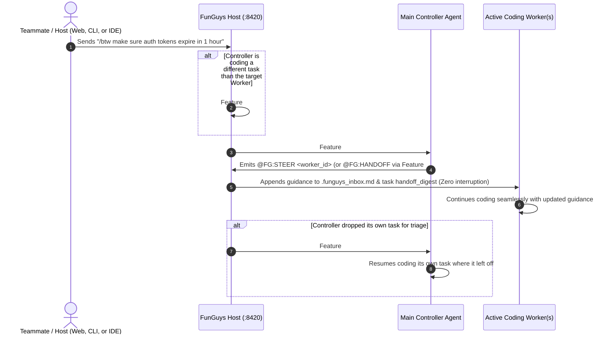

# FunGuys — Human-Readable Plan: Network-Wide `/btw` Swarm Terminal & Controller Triage

## 1. Executive Summary
Previously, the `/btw` ("By The Way") live-steering feature had two limitations:
1. **Access Limitation:** Only someone logged into the host website with the secret `admin_token` could view the dashboard or type `/btw` into the chat box. Teammates connected via worker tokens could not sign into the website or send `/btw` from their terminal or IDE.
2. **Routing Limitation:** When `/btw` was sent with `Auto` selected, the backend bypassed the Main Controller and routed the note to whichever random worker happened to appear first in the `WORKING` list.

This upgrade transforms `/btw` into a **Network-Wide Controller-Triaged Swarm Terminal** while leveraging **Feature #9 (Git WIP Checkpointing & Task Self-Reclaim)**, **Feature #2 (Controller Arbitration & Steering)**, and **Feature #4 (On-Demand Context Handoff)** so neither the Controller nor any active Worker loses work or gets interrupted.

---

## 2. How Teammates & the Host Use `/btw` Across the Network

Every member of the team now has three ways to send `/btw` guidance without needing the host's private `admin_token`:

1. **On the Host Website (Swarm Terminal):**
   - Teammates can sign into the Mission Control website (`http://<host-ip>:8420`) using their **Worker Token** (or Invite Token) in addition to the Admin Token.
   - Worker-authenticated teammates get read access to the live dashboard (`/api/state` and `/ws` WebSocket) and full access to the **Swarm Terminal** (`/api/chat/ask` and `/api/chat/btw/end`), while destructive admin endpoints (`/api/host/restart`, `DELETE /api/tasks`, `DELETE /api/agents/{id}`) remain strictly locked to the Host Administrator.
2. **Directly Inside Any Running PowerShell / Bash Worker Window:**
   - While `runtime.py` is running in a teammate's terminal, a background console listener watches standard input (`stdin`).
   - A teammate can type `/btw <guidance>` (or any question) directly into their PowerShell/Bash worker window and press **Enter** to send it to the host's `/api/chat/ask` endpoint.
   - Also adds `uv run funguys btw "<message>"` to the CLI for quick one-off commands.
3. **Inside Desktop IDEs (Cursor, Windsurf, Claude Desktop, VS Code):**
   - Adds the `fg_btw` tool to the stdio MCP server (`funguys/mcp_bridge/server.py`) so IDE agents and teammates can send `/btw` guidance directly from their editor.

---

## 3. How the Controller & Workers Handle `/btw` Without Losing Progress

### Key Safeguards:
- **Zero Worker Interruption:** The target worker's CLI subprocess is never killed or restarted. Its background heartbeat thread writes the guidance into `.funguys_inbox.md` in real time.
- **Zero Controller Work Lost:** If the Controller was coding another task when `/btw` arrived, `drop_task_for_controller(allow_self_reclaim=True)` checkpoints its uncommitted files to Git (`wip-handoff-...`), lets the Controller triage the `/btw`, and immediately re-assigns the task back to the Controller in the `finally` block.
- **Single-Agent Swarm Compatibility:** If only 1 agent is connected (so the Controller *is* the sole working agent), it stays in `WORKING` status without dropping its task, preserving 100% compatibility with existing single-agent `/btw` regression tests.
