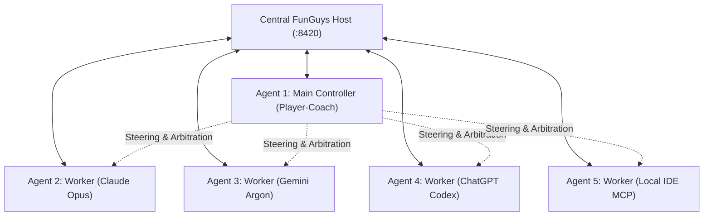
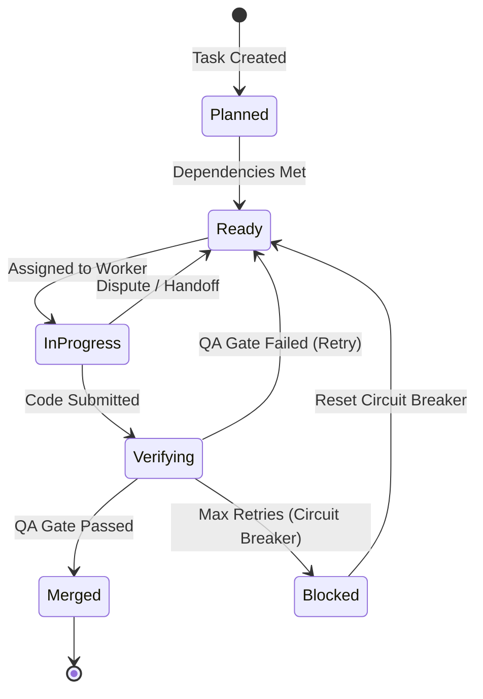

# FunGuys Complete User Guide & Feature Manual

Welcome to the **FunGuys User Guide**. This manual details every capability, command-line interface, web dashboard control, API endpoint, and architectural workflow in FunGuys.

---

## Table of Contents
1. [Architecture & System Overview](#1-architecture--system-overview)
2. [Installation & Prerequisites](#2-installation--prerequisites)
3. [CLI Reference & Commands](#3-cli-reference--commands)
4. [Authentication & Multi-User Security](#4-authentication--multi-user-security)
5. [The Player-Coach Swarm Architecture](#5-the-player-coach-swarm-architecture)
6. [Work-Importance Model Routing & LLM Profiles](#6-work-importance-model-routing--llm-profiles)
7. [Worker Onboarding & Connectivity Options](#7-worker-onboarding--connectivity-options)
   - [Standard CLI Workers](#standard-cli-workers)
   - [IDE Stdio MCP Workers (Cursor, Windsurf, VS Code, Claude Desktop)](#ide-stdio-mcp-workers)
8. [Task Lifecycle & DAG Management](#8-task-lifecycle--dag-management)
9. [Controller C2 Operations & Live Steering](#9-controller-c2-operations--live-steering)
   - [Controller Designation](#controller-designation)
   - [Automatic Mid-Work Task Checkpointing & Handoff](#automatic-mid-work-task-checkpointing--handoff)
   - [Dispute Arbitration & Worker Escalation](#dispute-arbitration--worker-escalation)
   - [Live Steering & Non-Destructive Inboxes](#live-steering--non-destructive-inboxes)
10. [Autonomous Grill-Me Architecture & Planning](#10-autonomous-grill-me-architecture--planning)
11. [3-Layer QA Verification & Circuit Breakers](#11-3-layer-qa-verification--circuit-breakers)
12. [Knowledge Graph, Blackboard & Web Search](#12-knowledge-graph-blackboard--web-search)
13. [Dual-Bucket Quota Tracking & Rate Limiting](#13-dual-bucket-quota-tracking--rate-limiting)
14. [HTTP API & WebSocket Endpoints](#14-http-api--websocket-endpoints)
15. [Troubleshooting & Recovery](#15-troubleshooting--recovery)

---

## 1. Architecture & System Overview

FunGuys is a distributed multi-agent coordination orchestrator and Command & Control (C2) engine designed to run 5-agent swarms across mixed environments (local IDE agents, terminal CLIs, and teammate laptops). 

### Key Capabilities:
- **Central Host Server:** FastAPI daemon that owns the task DAG, SQLite state store (`.funguys/state.db`), Git workspace management, and WebSocket live event stream.
- **Player-Coach Model:** A single agent can serve as both the active Main Controller (managing the swarm, arbitrating disputes, steering) and an active coder.
- **Isolated Worktrees:** Every task is assigned to an isolated Git worktree (`.funguys/workspaces/`). Changes are never committed to your working tree until verified.
- **3-Layer QA Gates:** Docker containerized or sandboxed verification that executes unit tests, linters, and headless browser checks before automatic merging.
- **Zero-Dependency Worker Runtimes:** Workers running on teammate machines only require standard-library Python (no packages needed).

---

## 2. Installation & Prerequisites

### Host Machine Prerequisites
- **Python:** 3.11 or newer
- **Package Manager:** `uv`
- **Version Control:** `git` (in PATH)
- **Container Engine (Optional but Recommended):** Docker (for sandboxed QA execution)
- **Tunneling (Optional):** `cloudflared` (if using `--tunnel` to expose host to remote teammates over the internet)

### Setup
```powershell
# Clone the repository
git clone https://github.com/Saucesandwich/Gaper-Bingzoid.git
cd "Gaper Bingzoid"

# Install project dependencies
uv sync

# (Optional) Build the local QA Docker container
docker build -t funguys-qa:local -f docker/qa.Dockerfile .
```

---

## 3. CLI Reference & Commands

FunGuys provides a comprehensive set of CLI commands through `uv run funguys`:

### 1. `funguys host`
Starts the central host orchestrator and web dashboard.
```powershell
uv run funguys host [OPTIONS]
```
- `--port, -p <int>`: Port to listen on (default: `8420`).
- `--host <str>`: Bind address. Defaults to `127.0.0.1`. Use `0.0.0.0` to allow local network teammates to join.
- `--tunnel, -t`: Automatically creates a Cloudflare HTTPS tunnel so remote teammates over the internet can join without port forwarding.

### 2. `funguys join`
Connects a real local CLI worker using a dashboard-issued invite token.
```powershell
uv run funguys join <HOST_URL> [OPTIONS]
```
- `--name, -n <str>`: Teammate name (default: `Teammate`).
- `--codename <str>`: Machine code name (e.g. `laptop-m3`, `desktop-rtx`).
- `--profile, -p <str>`: Canonical LLM profile key (e.g. `claude-opus`, `gemini-argon-flash`).
- `--token <str>`: Invite token or saved worker credential (can also be passed via `FUNGUYS_WORKER_TOKEN`).
- `--used-pct <float>`: Initial quota usage percent (0–100).

### 3. `funguys btw`
Sends a `/btw` live steering note directly to the Main Controller from any terminal window without opening a browser:
```powershell
uv run funguys btw "<MESSAGE>" [OPTIONS]
```
- `--host-url <str>`: URL of the running FunGuys host (default: `http://localhost:8420`).
- `--token <str>`: Worker token or admin token (reads `.funguys/admin_token` automatically if present on host).

### 4. `funguys mcp-worker`
Launches a JSON-RPC 2.0 stdio Model Context Protocol (MCP) server so desktop IDEs (Cursor, Windsurf, VS Code, Claude Desktop) can act as swarm workers or Controllers.
```powershell
uv run funguys mcp-worker [OPTIONS]
```
- `--host-url <str>`: URL of the running FunGuys host (default: `http://localhost:8420`).
- `--token <str>`: Worker token or admin token (can also use `FUNGUYS_WORKER_TOKEN`).
- `--name, -n <str>`: Agent name (default: `IDE-Agent`).
- `--profile, -p <str>`: Profile key (default: `mcp-ide`).
- `--controller / --no-controller`: Promote this IDE agent to Main Controller on launch (default: `no-controller`).

### 5. `funguys graph`
Inspects workspace dependencies, AST symbols, and cross-file relationships using the built-in Graphify engine.
```powershell
uv run funguys graph [WORKSPACE] --query <QUERY>
```

### 6. `funguys simulate`
Runs a disposable multi-agent hackathon simulation without modifying your real Git project repository or database state.
```powershell
uv run funguys simulate
```

---

## 4. Authentication & Multi-User Security

FunGuys uses a two-tier authentication model:

### 1. Host Administrator Token (`admin_token`)
- Stored on the host at `.funguys/admin_token`.
- Grants full administrative privileges: restarting the host, killing agents, creating/deleting tasks, arbitrating disputes, and force-merging code.
- **Security Rule:** Keep this token secret on the host machine. **Do not share this token with teammates.**

### 2. Worker Invitations & Teammate Sessions (`invite` & `worker_token`)
- Generated in Mission Control under **Workers & Invites** $\to$ **Invite a worker** (`POST /api/invites`).
- Invite tokens expire in **1 hour** and are single-use.
- When a teammate connects, the host enrolls them and issues a scoped `worker_token` (saved in `~/.funguys/workers/<machine>.json`).
- **Teammate Website Sign In:** Teammates can use their `worker_token` to sign into the Mission Control website at `http://<host-ip>:8420`. They gain access to view the live dashboard (`/ws` WebSocket stream) and submit `/btw` guidance through the Swarm Terminal (`/api/chat/ask`), while destructive operations (`/api/host/restart`, deleting tasks) remain strictly locked to the Administrator.
- **Pure Terminal Execution:** Teammates do not need to open a browser at all. They can run assignments and send `/btw` steering commands entirely inside their PowerShell or Bash window.

---

## 5. The Player-Coach Swarm Architecture

FunGuys features a **5-Agent Swarm (Model A: Player-Coach)**:



- **Player-Coach Concept:** The Controller is not a wasted idle agent. When there are no supervisory tasks or disputes to arbitrate, the Controller actively takes on coding tasks.
- **Instant Drop on Demand:** When promoted or summoned to arbitrate, the Controller automatically checkpoints its current work in Git (`wip-handoff-...`), frees its slot, and addresses the coordination issue immediately.
- **Automatic Resume:** Once arbitration is resolved, if all other workers are busy, the Controller automatically re-claims its own prior coding task and resumes from its exact Git commit.

---

## 6. Work-Importance Model Routing & LLM Profiles

Rather than routing solely on arbitrary token counts, FunGuys routes tasks based on **architectural importance**:

| Profile Key | Provider | Planning Model | Core / Important Coding | Gruntwork Scaffolding | Testing Suite | Planning Priority |
| :--- | :--- | :--- | :--- | :--- | :--- | :--- |
| **`mcp-ide`** | Desktop IDE MCP | Assigned via Host | Assigned via Host | Assigned via Host | Assigned via Host | **Rank 1 (Top)** |
| **`claude-opus`** | Anthropic | Claude Opus (High) | Claude Sonnet (High) | Claude Haiku | Sonnet / Haiku | Rank 2 |
| **`gemini-argon-flash`** | Google | Gemini Argon (Med) | Gemini 2.5 Flash | Gemini Flash-Lite | Gemini Flash | Rank 3 |
| **`codex-pro`** | OpenAI | ChatGPT Astra (Low) | Codex Pro | Codex Mini | Codex Mini | Rank 4 |

### Task Importance Categories
1. `planning`: Architecture, contract specifications, high-level design.
2. `important_coding`: Security-critical modules, core algorithms, database schemas.
3. `gruntwork`: Boilerplate scaffolding, HTML layouts, repetitive tests.
4. `testing`: Test suite execution, verification scripts.

---

## 7. Worker Onboarding & Connectivity Options

### Standard CLI Workers
Teammates on Windows, macOS, or Linux can join using a one-line command without installing the `funguys` repo:

1. **Windows (PowerShell):**
   ```powershell
   irm "http://<HOST_IP>:8420/join.ps1?token=<INVITE_TOKEN>&profile=gemini-argon-flash" | iex
   ```
2. **macOS & Linux (Bash):**
   ```bash
   curl --fail -sSL "http://<HOST_IP>:8420/join.sh?token=<INVITE_TOKEN>&profile=claude-opus" | bash
   ```

### IDE Stdio MCP Workers
To attach Cursor, Windsurf, Claude Desktop, or VS Code:

1. In your IDE MCP configuration file (e.g., `claude_desktop_config.json` or Cursor Settings $\to$ MCP), add:
   ```json
   {
     "mcpServers": {
       "funguys": {
         "command": "uv",
         "args": [
           "--directory", "C:/path/to/Gaper Bingzoid",
           "run", "funguys", "mcp-worker",
           "--host-url", "http://127.0.0.1:8420",
           "--name", "Cursor-IDE",
           "--token", "<WORKER_OR_ADMIN_TOKEN>"
         ]
       }
     }
   }
   ```
2. The IDE will automatically register the FunGuys MCP tool suite:
   - `fg_get_assignment`: Claim the next assignment.
   - `fg_heartbeat`: Report progress and stream log messages.
   - `fg_submit_task`: Submit completed code for 3-layer QA verification.
   - `fg_dispute`: Escalate a blocking issue to the Controller.
   - `fg_handoff`: Request on-demand context reset or delegate to another agent.
   - `fg_btw`: Send `/btw` guidance to the Main Controller to steer active workers non-destructively.
   - `fg_blackboard`: Read or post shared architecture notes.
   - `fg_graphify`: Query repository AST and symbol relationships.

---

## 8. Task Lifecycle & DAG Management

FunGuys models work as a Directed Acyclic Graph (DAG) with strict contract validation.



### Key Task Operations
- **Task Creation (`POST /api/tasks`):** Defines title, target files, acceptance criteria, dependencies, verification command, and importance category.
- **Contract Slicing:** Slices out relevant sections of `CONTRACTS.md` so workers only receive the specifications relevant to their target files.
- **Submission (`POST /api/tasks/{id}/submit`):** Commits the worker's changes and triggers automated QA verification.
- **Circuit Breaker:** If a task fails verification 3 times consecutively, it trips the circuit breaker to prevent quota loops. A human or the Controller must inspect the failure and reset it (`POST /api/tasks/{id}/reset-circuit-breaker`).

---

## 9. Controller C2 Operations & Live Steering

### Controller Designation
Promote any agent to Main Controller:
- **Web UI:** Mission Control $\to$ Click "Make Controller" on the agent's card.
- **API:** `POST /api/agents/{agent_id}/controller`

### Automatic Mid-Work Task Checkpointing & Handoff
When an agent is promoted or summoned for arbitration while actively coding:
1. The host commits all uncommitted changes to a dedicated WIP branch (`wip-handoff-<task_id>-<timestamp>`).
2. The active task is reset to `ready` status with `git_wip_revision` recorded.
3. The agent is freed to take up Controller duties.

### Dispute Arbitration & Worker Escalation
When a worker encounters a blocker, missing dependency, or contradictory contract:
1. **Trigger:** The worker emits `@FG:DISPUTE reason="..."` in its logs or calls the `fg_dispute` MCP tool.
2. **Escalation:** The host pauses the task, releases the worker, and notifies the Controller.
3. **Arbitration Prompt:** The Controller receives a specialized diagnostic prompt (`controller_arbitration_prompt`) with a snapshot of the workspace, blackboard, and dispute context.
4. **Resolution:** The Controller issues steering commands, updates contracts, or reallocates subtasks.
5. **Self-Reclaim:** If all other workers are busy, the Controller's prior coding task sets `preferred_agent_id = ctrl_id`, allowing the Controller to automatically resume its coding task after resolving the dispute.

### Live Steering & Non-Destructive Inboxes (`/btw`)
- **Live Steering (`POST /api/agents/{agent_id}/steer`):** Send a high-priority prompt to an agent without resetting its context.
- **Network-Wide `/btw` Steering:** Send background notes to active workers without interrupting or restarting their coding subprocess:
  - **In Running Worker Consoles:** Teammates can type `/btw <guidance>` directly into their active PowerShell/Bash worker window and hit Enter.
  - **CLI One-Liner:** Run `uv run funguys btw "<guidance>"` from any terminal.
  - **Swarm Terminal on Web:** Type in the **Swarm Terminal** at `http://<host-ip>:8420`.
  - **IDE MCP:** Call the `fg_btw` tool from Cursor, Windsurf, Claude Desktop, or VS Code.
- **Controller-Mediated Triage & Self-Reclaim:** The Main Controller evaluates the `/btw` against the swarm roster, emits targeted `@FG:STEER` directives, and streams the guidance into `.funguys_inbox.md`. If the Controller was coding a separate task when the `/btw` arrived, it checkpoints its task to Git, triages the note, and automatically reclaims its own task afterward.

---

## 10. Autonomous Grill-Me Architecture & Planning

The **Grill-Me Engine** (`funguys/host/architect.py`) automates architecture planning through an interactive interview process:

1. **Start Session (`POST /api/grill/start`):** Provide a project goal or feature specification.
2. **Clarifying Questions:** The architect analyzes ambiguity and asks targeted clarifying questions with multiple-choice and open-ended options.
3. **Compile Plan (`POST /api/grill/compile`):** Once answers are submitted, the engine compiles a structured, dependency-ordered task graph and `CONTRACTS.md`.
4. **Approval (`POST /api/project/approve`):** Approving the plan unlocks the tasks for assignment across the swarm.

---

## 11. 3-Layer QA Verification & Circuit Breakers

When a worker submits a task, FunGuys executes a 3-layer verification check in an isolated Git worktree:

1. **Layer 1: Static Code Checks & Linter**
   - Syntax validation, type checking, formatting requirements.
2. **Layer 2: Target File Scope Enforcement**
   - Ensures the worker modified only its allowed target files and did not introduce out-of-scope edits or overwrite protected contracts.
3. **Layer 3: Functional Tests & Sandboxed Verification**
   - Runs the task's configured verification command inside the `funguys-qa:local` Docker container (or sandboxed host if `FUNGUYS_TRUSTED_EXECUTION=1` is set).
   - If tests pass, changes are squash-merged into the main branch.

---

## 12. Knowledge Graph, Blackboard & Web Search

- **Graphify Engine (`POST /api/graphify/query`):** Parses the project AST to identify call graphs, class hierarchies, and symbol references across files. Workers can query how unfamiliar symbols are used before making modifications.
- **Shared Blackboard (`GET / POST /api/blackboard`):** A shared append-only scratchpad where agents post architectural findings, schema definitions, and coordination notes.
- **Web Search & Docs Fetcher (`POST /api/tools/web-search`, `POST /api/tools/fetch-docs`):** Real-time web searching and markdown documentation retrieval for third-party libraries and APIs.

---

## 13. Dual-Bucket Quota Tracking & Rate Limiting

FunGuys monitors worker rate limits to prevent model exhaustion:

- **Dual-Bucket Model:** Tracks 5-minute bursting quotas and 5-hour rolling quotas.
- **Automatic Cooldown:** When an agent reports high quota utilization or rate limits (`POST /api/agents/{id}/quota`), the scheduler pauses new high-rate assignments to that worker.
- **Context Handoff vs. Quota Cooldown:** The `POST /api/agents/{id}/handoff` endpoint resets an agent's context window on demand without locking the agent in a 60-minute quota cooldown.

---

## 14. HTTP API & WebSocket Endpoints

### Core Endpoints
| Method | Endpoint | Description |
| :--- | :--- | :--- |
| `POST` | `/api/session` | Sign in with administrator token or teammate worker token. |
| `DELETE` | `/api/session` | Log out of administrator or worker session. |
| `POST` | `/api/invites` | Create a 1-hour single-use worker invite token. |
| `GET` | `/api/state` | Full JSON state dump (agents, tasks, blackboard, stats). |
| `WS` | `/ws` | Real-time WebSocket event broadcast stream (admin & worker authenticated). |
| `POST` | `/api/chat/ask` | Send a project question or `/btw` live steering note (triaged by Controller). |
| `POST` | `/api/chat/btw/end` | Close an active `/btw` side-conversation and commit guidance to task digest. |

### Agents & Controller
| Method | Endpoint | Description |
| :--- | :--- | :--- |
| `POST` | `/api/agents/register` | Enroll a new worker using an invite or worker token. |
| `GET` | `/api/worker/assignment` | Worker endpoint to pull the next available task. |
| `POST` | `/api/agents/{id}/heartbeat` | Send progress, current state, and stream terminal logs. |
| `POST` | `/api/agents/{id}/controller` | Promote an agent to Main Controller (drops coding task to WIP). |
| `POST` | `/api/agents/{id}/handoff` | Mid-task checkpoint and on-demand context reset. |
| `POST` | `/api/agents/{id}/steer` | Send live steering instructions to an active worker. |
| `POST` | `/api/controller/arbitrate` | Summon the Controller to resolve a worker dispute. |
| `DELETE` | `/api/agents/{id}` | Terminate and unenroll a worker. |

### Tasks & DAG
| Method | Endpoint | Description |
| :--- | :--- | :--- |
| `POST` | `/api/tasks` | Create a new task in the DAG. |
| `POST` | `/api/tasks/{id}/submit` | Submit completed code for QA verification. |
| `POST` | `/api/tasks/{id}/execution-failed` | Report execution failure and request retry. |
| `POST` | `/api/tasks/{id}/reset-circuit-breaker` | Reset a tripped circuit breaker. |
| `POST` | `/api/tasks/{id}/claim-human` | Claim a task for manual human intervention. |

---

## 15. Troubleshooting & Recovery

### Host Lock Contention
- **Symptom:** `HostLockError: Another host process is already running.`
- **Fix:** Only one host can own a `.funguys` directory at a time. Terminate the previous host process or remove the stale lock file `.funguys/host.lock` if the process was abruptly killed.

### Worker Reconnection
- **Symptom:** Teammate disconnected or closed terminal.
- **Fix:** Teammate can run the same join command using their existing `--codename`. The host recognizes the reconnecting machine and re-assigns its active work without losing state.

### Standalone Worker Runtime
- FunGuys serves the standalone worker script via `GET /worker.py`.
- The bootstrap launcher verifies the integrity of this file using SHA-256 before execution.
- Workers require no external packages—only standard Python 3.11+.
